This devlog records and expands upon my experience of making the game **Rise&Shine** for [The Captain Coder](https://discord.gg/vn6WcESkPq)’s [Learn You A Game Jam 2024](https://itch.io/jam/learn-you-a-game-jam-2024). 

### Before You Read

The game is open-source! You can check the source-code out in [this repository](https://github.com/ImTani/LYAGJ2024).

If you'd rather skip to a specific section, the table of contents will take you there. [[wide: It is to the right of this text.]] [[band: It is just above this text.]] [[menu: The menu button will let you access it!]] Although if it is your first time reading, I highly suggest reading the entire thing. All text that looks [like this](https://www.youtube.com/watch?v=dQw4w9WgXcQ) is a hyperlink, meaning it will take you to another webpage. Most of these links are helpful reading materials about the mentioned topics, give them a read to learn more. Although educational content, this devlog is not written as a tutorial, but rather a walkthrough of my own process of making this game and what I learnt through said process. It will contain helpful information, but it won’t be a step-by-step guide for you to make the same game.

# Day 1 | June 19

## Preparation

### Ideas and Addons

The jam has just begun, and the theme has come out to be `Only One Inventory Slot.` Right off the bat my plan was to have a platformer game where you can only `Carry` one item on you at a time. Going the most convenient route, I decided to make this game a puzzle-platformer. My game engine of choice for this jam was [Godot](https://godotengine.org). The very first thing I did was to scour Godot’s [Asset Library](https://godotengine.org/asset-library/asset), looking for useful assets that may potentially make things easier for me. The ones I decided to go with were:

1. **[TODO Manager](https://github.com/OrigamiDev-Pete/TODO_Manager):** To manage my tasks, because I’m a *very* forgetful individual and I **know** that I will forget what I was doing sooner or later. This plugin allows me to leave comments within my code with keywords like #TODO and points me to them through its interface, making it easier to keep track of my plans.
2. **[Signal Visualizer](https://github.com/Ericdowney/SignalVisualizer):** This plugin displays a scene's signals and connections in an easy to read graph, making the signals easier to comprehend.
3. **[Phantom Camera](https://phantom-camera.dev):** This plugin extends the functionality of the cameras in Godot, cutting down on the time I’d require to figure out the camera system.

### Assets

After this, I head out to [Kenney’s](https://kenney.nl) to look for assets for the game. I tried using the [1-Bit Pack](https://kenney.nl/assets/1-bit-platformer-pack) for a short while but eventually decided to switch to the [Pixel Platformer 2D Asset Pack](https://kenney.nl/assets/pixel-platformer). I spent a lot of time deliberating over the feel and style of the game, and after much consideration, this was the look I went with. 

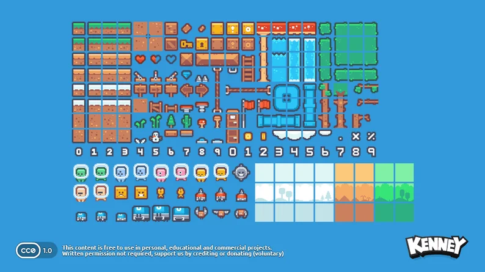

I added a `Tilemap` to the scene and configured it's `Tileset` to match my assets. You can check out how you can do that [here](https://docs.godotengine.org/en/stable/tutorials/2d/using_tilemaps.html). I added a basic Physics Layer to the grass tiles and placed them into the scene. After that, I made the Player scene using Godot’s built-in `CharacterBody2D` node. As we are only setting things up for now, I just went with the default script template that comes with Godot. As for the camera, I want to follow *behind* the player with a slight delay, [damping](https://simple.wikipedia.org/wiki/Damping), as one may call it.

<aside>
🤔 Did you know that prefixing a Wikipedia URL with ‘simple' shows you a version of the page with simplified language? The link to the damping Wikipedia article is an example!
</aside>

## Camera Setup

### Interpolation

For my camera management, I decided to use the aforementioned PhantomCamera plugin. Godot’s `CharacterBody2D` node inherits from `PhysicsBody2D` and thus, is handled by Godot’s physics engine. One of the problems with this is that Godot doesn’t have Physics Interpolation in the latest release available at the time of writing. Interpolation is **a technique to infer information from a discrete and limited set of data.** In Layman’s terms, it means to approximate data from data that we already have. There’s a concept of [**Tweening**](https://en.wikipedia.org/wiki/Inbetweening) in animation, you can think of it as that, but for physics. 


This essentially would make Godot’s physics be *smoother.*  Why this matters to me, is because PhantomCamera doesn’t handle `PhysicsBody2D` very well due to the lack of this feature, causing my camera to be jittery.


And for this exact reason I decided to port over my project to Godot’s latest beta release at the time, [Godot 4.3 Beta 1](https://godotengine.org/download/archive/4.3-beta1/), which fortunately adds Physics Interpolation to the engine. Now our camera works fine!


Okay it’s hard to tell from the gif but it’s better alright? This is also where I switched the assets I was using. Oh and, see that little goblin looking dude on the screen? It was made by yours truly! I decided to try my hand at pixel art as well, using [Aseprite](https://www.aseprite.org), a pixel-art software. Or if you’re looking for a free alternative, [LibreSprite](https://libresprite.github.io/#!/), an Aseprite fork.

## Tilemap

I was satisfied with the camera for the time being and moved on to setting up my Tilemap. I should also state here that this is my first time working with a tile-map based project seriously, so this is a new experience. Until now, I’ve been painting the tiles myself, as in I manually put specific tiles into the world.


This is far too cumbersome and time consuming, and if there’s one thing you should know about me, is that I’m a very ~~lazy~~ efficient individual. This is why I decided to tackle the challenge of setting up [*auto-tiling*](https://docs.godotengine.org/en/stable/tutorials/2d/using_tilesets.html#doc-using-tilesets-creating-terrain-sets) for my Tilemap, or as Godot calls it, using Terrains[.](https://docs.godotengine.org/en/stable/tutorials/2d/using_tilemaps.html#handling-tile-connections-automatically-using-terrains) Auto-tiling detects the placement of a tile—whether it's a corner, far left, top, or any other position—and automatically selects and places the appropriate tile from the Tilemap. Now, making levels is very straightforward.


## Parallax Background

After this, I started iterating on my background, trying to go for a simple [parallax effect](https://en.wikipedia.org/wiki/Parallax_scrolling). I used the assets from the pack and also made my own. This is very easy to implement in Godot due to the built-in `Parallax2D` nodes. I just had to put my backgrounds on different layers and voila! The illusion of depth! I also made the separated clouds have a `x_scroll`,  meaning they will automatically move to the left ever so slightly every frame, making it look like they’re moving. Did I mention that the layers are also repeated? This makes it so that we never run out of background, and I can be— ahem, *efficient*, by not having to manually place long strips of background tiles. And all of this without writing a single bit of code too, Godot makes it really easy for you to achieve some things.


At this point, I was pretty tired, so I decided to call it a day. I was quite satisfied with my progress for the day.

# Day 2 | June 20

## The Wave Shader

I woke up, drank my afternoon coffee, and went straight back to my computer. Today’s agenda: **[Shaders](https://docs.godotengine.org/en/stable/tutorials/shaders/introduction_to_shaders.html).** Shaders are a special kind of program that run on your GPU, which can handle thousands of tasks at the same time, also known as running in *parallel,* which is ideal for shaders that need to run for every pixel (or less) on your screen at the same time. You can find some awesome shaders for Godot at [Godot Shaders](https://godotshaders.com).

See, shaders are something I have never dealt with before, and I am quite aware of the wonderful and absolutely amazing things that are made possible by them. So I decided to try my hands at it too. I wanted to start simple, my task was to make this very stationary cloud wave up and down.

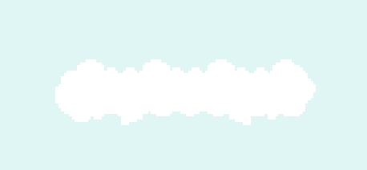

This could be very easily achieved using an `AnimationPlayer` to animate it, but shaders sound fun, (also they’re much more efficient to calculate and execute for the engine than animations), so we’ll go with that. In Godot, you can write shaders through code using Godot’s Shading Language, but I decided to use [VisualShaders](https://docs.godotengine.org/en/stable/tutorials/shaders/visual_shaders.html). Think visual scripting, but for shaders. (duh.)

Shaders have many capabilities but are primarily divided into two main categories: Vertex and Fragment. Vertex shaders, as the name suggests, manipulate the vertices and their positions within a graphic element (mesh). Fragment shaders, on the other hand, operate on every pixel of the graphic, making them useful for manipulating colors and similar effects. Since I want to make the cloud wave up and down, I need to adjust the position of the vertices accordingly, so I will use a Vertex shader.

As I create (and connect to my cloud) a new `VisualShader` resource in the project, I am greeted with this slightly scary interface:

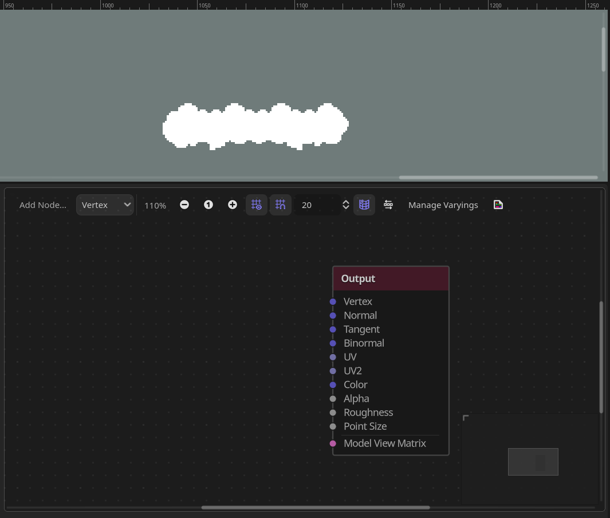

### The Sine Function

There’s a lot of options here but we only want to mess with one of those, the **Vertex**. Before I start working on the actual shader, let me break down how I plan for it to work. I wish to utilize a [Sine](https://www.cuemath.com/trigonometry/sine-function/) function to generate the motion. Sine waves are cyclic in nature, and are also famously utilized in many other things in game-dev such as bobbing animations or [rendering oceans](https://youtu.be/PH9q0HNBjT4?si=gQ7xk1gmE392K_o2) (yes.). Learn your trigonometry! This is where it helps you!


As the sine wave cycles between two points infinitely, it is the perfect choice for our wave shader. This is how I’ve implemented the shader:

We take in the `time` input, think of it as a constant stream of input to push into our sine wave, the fuel that keeps it cycling. I multiply the `time` with a `FloatParameter` which I call `wave_speed`. You can think of  `Parameters` as shader variables, because that’s what they are.  I can edit these in the inspector later on without having to mess with the shader again. The `wave_speed` does exactly what you’d expect it to, it handles the frequency of the sine function, allowing me to manipulate how long a cycle lasts, and consequently, how fast our wave oscillates.


After connecting the output from the `Multiply` node to a `Sin` function node (*Sine* is also written as *Sin*, think Sin, Cos and Tan.), we can see that it is working as intended. You can press the eye icon next to the output of most nodes to have Godot visualize them, as I am doing here. Did I mention that I’m not following any tutorials for this? They are definitely a good way to learn but sometimes, you have to explore and have some fun! Unguided learning is also very good. I’d also encourage you to mess around with some nodes in the Visual Shaders! And if you want to learn, [this tutorial](https://youtu.be/nyFzPaWAzeQ?si=g0DH0pcvWi86Nkad) by Godotneers will introduce you to most things that you’d want to do.


Now, lets try to get vertices to move. I snooped around the nodes and found this little thing:

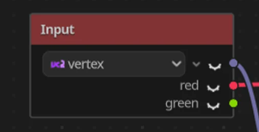

As you may notice, This node is an `Input` node, if you remember from above, our `Time` node was also an `Input` node . These nodes allow you to input data from the engine into your shaders, such as time elapsed, or the current position of every vertex. You might also notice that this node has **3** outputs, instead of the usual **1,** this is because up until now we had been working with **[Float](https://docs.godotengine.org/en/stable/classes/class_float.html)** numbers. This is a datatype that handles decimal numbers such as 0.001 or 1.343, but the vertex node returns *positions,* or specifically, *Vector2* data which will be in 2 axes, now if you know anything about co-ordinate geometry, you’d have an easier time understanding this next section, but I’ll try to make it as simple as I can for you. Those who already understand it may skip it if they wish to do so.

### The 2D Coordinate System

")

Think of 2D space as a grid. Let's call a random point the **Origin** and assume that it is where the world starts from. Now, let's assign all **up and down** (vertical) movement on this grid to the **Y-Axis**. When you move up, the Y-coordinate will *increase*, and when you move down, it will *decrease*. Similarly, we can assign all **left and right** (horizontal) movement to the **X-Axis**. When you move to the right, the X-coordinate will *increase*, and when you move to the left, it will *decrease*. BUT! Godot over here likes being quirky and prefers its Y-axis flipped. The Godot switch will show you how the engine does it!


Now, let's assign a value to each unit on the grid. Let's say that one box on the grid is 1 *unit* tall and 1 *unit* wide. So, when you move left one time, you’re moving one unit negative on the X-Axis. We can use these numbers to describe our position on the grid. If you are on the 4th unit on the X-Axis and the negative 8th unit on the Y-Axis, you could say it like that, or you could use a simple notation: you are at point (4, -8) on the grid. This is called a **coordinate**, which is where the name of the system comes from. Another example is the point (4, 3) on the grid above. Anywhere you work with computer graphics, this system will undeniably show up, as is the case for our shader.

<aside>
🤔 Since the Origin is the center of our system, it is assigned the coordinate (0,0)! Similarly, if a point **lies** on the X-Axis, its Y-coordinate would be 0, and if it **lies** on the Y-Axis, its X-coordinate would be 0.
</aside>

If you want to read more about this, check out [this page](https://docs.godotengine.org/en/stable/tutorials/math/vector_math.html#coordinate-systems-2d). They explain it better than I could.

I should also mention that not only shaders but the positions of **all** 2D and 3D nodes in Godot use this coordinate system. This is essential information for game developers, so make sure to remember it!

### Vectors

With that out of the way, let’s get back to Vectors. I won’t explain Vector math to you here, but you can check out this page for some basics. But we are not talking about Vectors here, we are talking about Godot’s [Vector2](https://docs.godotengine.org/en/stable/classes/class_vector2.html). The `Vector2` data type is a 2-element structure that can be used to represent 2D coordinates or any other pair of numeric values. Let’s say, velocity, or even *vertex positions.*

See where I’m getting at?

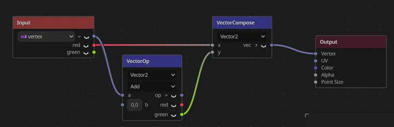

In this snippet, you can see that we’re getting the `vertex` input to retrieve all vertices and performing a *vector operation* on them, which is math, but with vectors. Here, we add two vectors together: one is the vertex positions, and the other is currently (0,0), so we’re effectively adding nothing.

You may notice that we are compositing (fancy term for creating) a new Vector using the **red** component from the original vertex positions and the **green** component from the added vector. In Godot's shaders, `RGB` notations are used instead of `XYZ`. So, red correlates to the X-Axis (horizontal component) and green correlates to the Y-Axis (vertical component) of our vector.

Essentially, we’re taking the original X-Axis of the `vertex` input and the Y-Axis of the added vector. Why are we doing this? Because we only want the cloud to move up and down, not left and right!

Now we can just plug the `Sin` wave into the vector that we are adding, where we were previously adding (0,0). And. . .


It. . .  *seems* to work? Can you see it? The really subtle movement? Let’s do something about it! I used the trust `FloatParameter` and `Multiply` node combination to add another variable to the shader, the wave *intensity.* This controls how far off the cloud goes up and down.

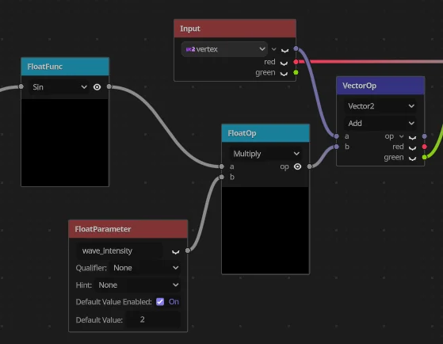

 Now changing these parameters to be higher, and:


Let’s. . . dial it down a bit. . .


{width=480 height=269 animated}

It works! Yay! Although I’m currently using the shader to make the clouds wave up and down, this can be used to make literally anything wave up and down. A great tool in my arsenal going forward!

And thus ended Day 2.

# Day 3 | June 21

## The Player

Alright, buckle up. We’re diving into deep nerd territory now.

### Inheritance and Composition

In the world of computer programming, there exist many [paradigms](https://simple.wikipedia.org/wiki/Programming_paradigm). One of the most commonly used paradigms for game development is [Object Oriented Programming (OOP).](https://simple.wikipedia.org/wiki/Object-oriented_programming) As the name would suggest, this type of programming is oriented around objects. Next is- just kidding. OOP is a type of programming that favors data *objects* over pure logic and functions. An object can be any sort of data structure that has its own unique functions and can interact with other elements in the program. This video is an excellent resource for understanding OOP. I won’t explain how OOP works because it is far too massive a topic for little tiny me, but I *will* tell you about Inheritance and Composition.

These words may sound alien at first, but at their cores, they are very simple concepts.

Imagine you have a garage full of different vehicles. Each vehicle serves a specific purpose—like a car for everyday commuting or a motorcycle for zipping through traffic. In programming, Inheritance and Composition are akin to different approaches to using and combining these vehicles.

**[Inheritance](https://simple.wikipedia.org/wiki/Inheritance_(object-oriented_programming))** is like starting with a basic vehicle that does what all vehicles do—moves you from point A to point B. From this basic vehicle, you can create specialized versions that add extra features or abilities, like turning your basic car into a sports car or a utility truck. In programming terms, this means creating new types of vehicles (or classes) that build upon existing ones, inheriting their fundamental capabilities and behaviors.


**[Composition](https://en.wikipedia.org/wiki/Object_composition)** on the other hand, is about assembling a vehicle with specific features from various parts. Just like assembling a custom toolkit, you might combine the speed of a motorcycle, the cargo space of a truck, and the fuel efficiency of a hybrid car to create a new vehicle tailored exactly to your needs.


Inheritance allows you to build upon existing vehicle designs, creating specialized versions that extend or modify their capabilities. Meanwhile, Composition lets you combine different vehicle features to create something entirely new and unique. Both approaches are powerful ways to organize and reuse code in programming, depending on how you want to design your software.

“But Tani, why are you yapping about these complex topics? They go right over my head!”, because you need to know about them to understand my player system, ye jerk.

### Entity Component System

This is the bread-and-butter of composition.

When you’re making a game, you’ve got all these different things going on: characters, enemies, items, and more. The Entity Component System (ECS) is a lifesaver when it comes to organizing these things. It is like the lifeblood of modularity.

In ECS, an **Entity** can be anything in your game—like a player, a monster, or even a power-up. Each Entity is made up of **Components**, which are like individual traits or characteristics. For example, a player Entity might have components for Health, Input and Movement.

These Components are designed to be super focused, each doing just one thing really well. This makes it easy to mix and match them—just like assembling a custom vehicle—to create different types of Entities.

But it doesn’t end there. The **System** part of ECS is where the magic happens. Systems are like the managers who oversee how Components interact and behave in the game world. They handle things like physics, rendering, or AI logic.

Godot doesn't do ECS by the book though, since my components carry their own logic instead of leaving it to actual `Systems`, but the idea of building a player out of small swappable parts is the same! 

So I could have a Health component and stick it right into my player, my enemies and even any breakable objects in the game.

[This short video](https://www.youtube.com/watch?v=74y6zWZfQKk) is an excellent resource for understanding these concepts!

Using this approach, and closely following [this video](https://www.youtube.com/watch?v=yzbxoZFsU2Y), I made my very own modular component based player!  

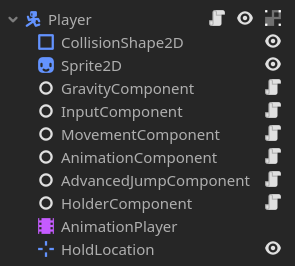

The Components are scripts that are all Classes and the central System for the ECS is the Player script.

```gdscript
extends CharacterBody2D

@export_subgroup("Nodes")
@export var gravity_component: GravityComponent
@export var input_component: InputComponent
@export var movement_component: MovementComponent
@export var jump_component: AdvancedJumpComponent
@export var animation_component: AnimationComponent
@export var holder_component: HolderComponent

func _physics_process(delta: float) -> void:

	var horizontal_input = input_component.input_horizontal

	gravity_component.handle_gravity(self, delta)
	movement_component.handle_horizontal_movement(self, horizontal_input)
	jump_component.handle_jump(self, input_component.get_jump_input(), input_component.get_jump_input_released())
	animation_component.handle_move_animation(horizontal_input)
	animation_component.handle_jump_animation(jump_component.is_going_up, gravity_component.is_falling, gravity_component.just_landed)

	move_and_slide()
```

This way, although the components handle their own tasks, the central control is still the Player script itself.

This is a little preview of what our player looks like now. You will also notice that I’ve changed the sprite again, this is only one of the many iterations that I go through, so get used to it.


This was also the time that I started working on my Item system, look at this seamless segue to the next section.

## The Item

### Inherited Scenes

Remember all that talk about Inheritance and Composition? If the Player follows a Composition-based system, then my Items are where I employ use of Inheritance. Remember, it’s never Composition versus Inheritance, it’s always Composition *and* Inheritance. Let me talk about the system to explain more.

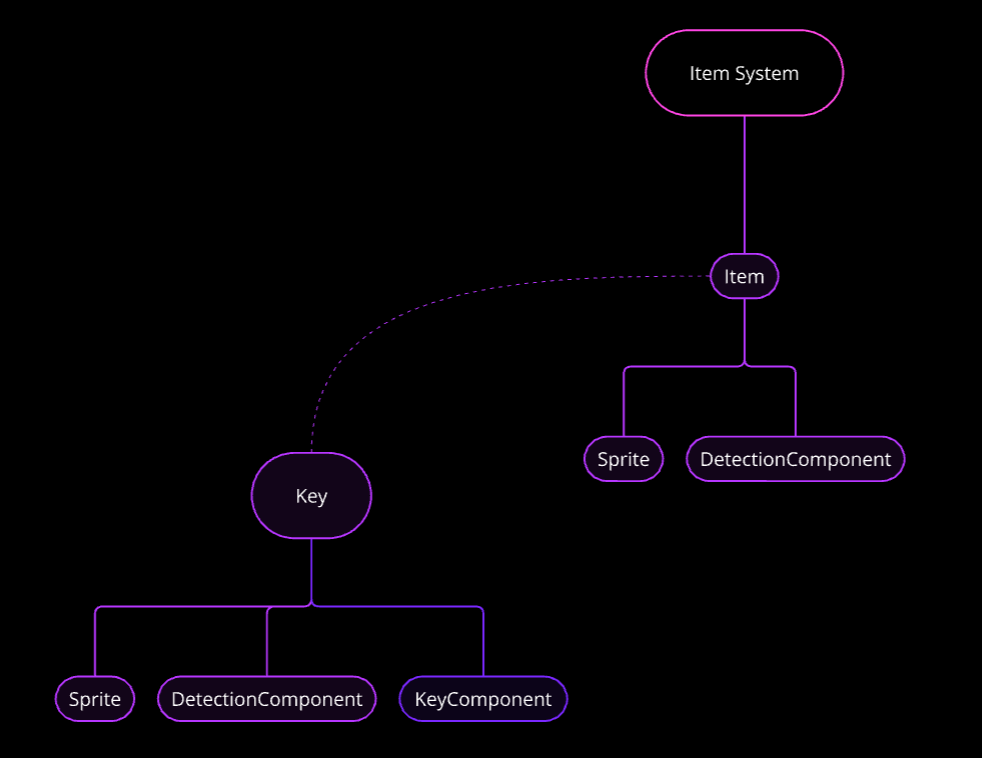

I plan on making a base Item scene that will contain all the logic and components that an Item should, and for specific use cases, such as a Key for example, we can make a new inherited scene from the Item scene and update it with new components etc. accordingly. Unfortunately, there is no official documentation for inherited scenes in Godot yet, but they work exactly how I’ve said, and you have to take my word for it.

You may also notice the `HolderComponent` on my player, along with a `HoldLocation` node, this is me trying to implement a mechanic that allows the player to *hold* or *carry* an item, tying in with the theme of the jam. Currently, all this system does is print debug statements in the console, still a lot of work to do.

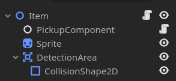

This is the hierarchy for my base item scene at the moment. We have a simple pickup component which check if the Player is inside the pickup range of the Item, and if so, asks the player to pick the Item up.

```gdscript
extends Node
class_name PickupComponent

@export_subgroup("Settings")
@export var detection_area: Area2D
@export var item: Item

func _ready() -> void:
	detection_area.body_entered.connect(_on_pickup)

func _on_pickup(body) -> void:
	if not body.has_node("HolderComponent"):
		return

	body.holder_component.pick_up(item)
```

This was also when I started work on the `ThrowerComponent.` The plan is to throw the item towards the location of the mouse cursor on click, but we’ll see how that goes.

At the moment, the system handles picking items up, and dropping them, which deletes them from the world. Keep in mind this can’t even be counted as a prototype at the moment, the system is still in its infancy.

Let me showcase the inherited scenes I talked about earlier now.

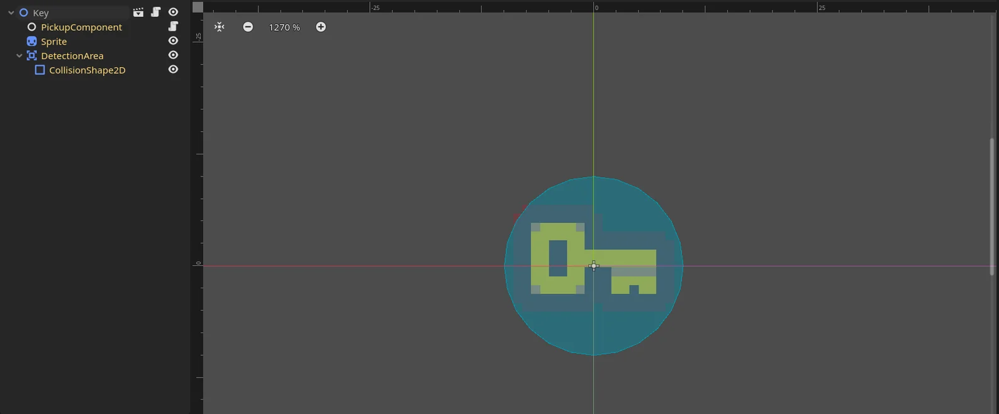

This is my Key scene at the moment, notice how the hierarchy is exactly the same as the item? That is because this is an inherited scene, made obvious by the names highlighted in yellow, meaning that the nodes have been inherited. You may also notice the key Sprite, this is one of the perks of inherited scenes. In our Item scene, I use a placeholder sprite and in my actual items I can just change the Sprite to match the items.

### Don’t Repeat Yourself

Around this time I also found myself needing to add the items back to the Tilemap whenever they were dropped, and for that I had to call this, not so little, snippet:

```gdscript
get_tree().get_root().get_node("/root/PlatformerWorld/Tilemap/Foreground").add_child.call_deferred(child)
```

To me, rewriting the same code again and again has always seemed to be an inefficiency, and I do not enjoy it, which is why I’m a staunch believer in the [DRY Principle](https://en.wikipedia.org/wiki/Don%27t_repeat_yourself).

<aside>
🤔 "**Don't repeat yourself**" (**DRY**) is a [principle](https://en.wikipedia.org/wiki/Principle#Principle_as_axiom_or_logical_fundament) of [software development](https://en.wikipedia.org/wiki/Software_development_process) aimed at reducing repetition of [information](https://en.wikipedia.org/wiki/Information_theory) which is likely to change, replacing it with [abstractions](https://en.wikipedia.org/wiki/Information_hiding) that are less likely to change, or using [data normalization](https://en.wikipedia.org/wiki/Data_normalization) which avoids redundancy in the first place.
</aside>

Simply put, If you find yourself writing the same piece of code over and over again, turn it into a smaller piece of code. To achieve this I decided to employ an [autoload a.k.a singleton](https://docs.godotengine.org/en/stable/tutorials/scripting/singletons_autoload.html).

Singletons are scenes or scripts that are always loaded in the background, and can be accessed from anywhere, regardless of scene or state in your game. I used this functionality to write a Utility script, inside of which I plan to put all the code I find too long to rewrite. For now, this is what we have:

```gdscript
extends Node

func _add_platformer_world_tilemap_child(child) -> void:
	get_tree().get_root().get_node("/root/PlatformerWorld/Tilemap/Foreground").add_child.call_deferred(child)
```

Now I can call the comparatively smaller function in my scripts and have to type less. ;)

The rest of the day involved boring debugging and more debugging, systems are hard to implement, and my `ThrowerComponent` just did not want to work, and would send all items to (0, 0) regardless of where I dropped them. I eventually did fix this bug, courtesy of the [Rubber Duck](https://en.wikipedia.org/wiki/Rubber_duck_debugging) method.

In my case, the rubber duck was also me. Turns out I was trying to set the position of the items before they even technically existed, and unfortunately for me, I can not tamper with the space-time continuum (yet.), thus I had to have my functions as [deferred calls](https://docs.godotengine.org/en/stable/classes/class_callable.html#class-callable-method-call-deferred), and then everything magically started working. This is also where I got off development for the day. 

# Day 4 | June 22

## Health, Damage and Respawns

With my game, I wanted to do something unique, something different, so I decided to venture into unexplored territory in platformer games. . . *Health Systems*. Just kidding. I’m not a platformer-maestro, but I do know that all good platformers feature some variation of health and damage systems, and so will my game.

I wrote a boilerplate HealthComponent script for the player to handle damage. It goes like this:

```gdscript
extends Node
class_name HealthComponent

@export var max_health: int = 3

var health: int
var is_alive: bool = true

signal died

func _ready() -> void:
	health = max_health

func handle_health() -> void:
	health = clamp(health, 0, max_health)

func take_damage(damage: float) -> void:
	health -= damage
	if health == 0:
		die()

func heal_health(healing: float) -> void:
	health += healing

func die() -> void:
	is_alive = false
	emit_signal("died")
```

I decided to go for the classic “3 Lives” approach rather than a health bar for this game. Now that we have health, lets also add some danger to our game.

### Hazards

Like Items, Hazards are going to be objects that share many similarities, such as:

- All Hazards have a HurtBox
- All Hazard have a CollisionShape
- All Hazards have a Sprite
- All Hazards need to handle dealing damage

And due to this, Hazards are also going to be inherited scenes, so I can do less work and gain more material. :D

I also a made a new `HurtComponent` for the Hazards.

```gdscript
extends Node
class_name HurtComponent

@export_subgroup("Settings")
@export var hurtbox: Area2D
@export var damage: int

func _on_hurt_box_entered(body: Node2D) -> void:
	var health_component: HealthComponent = utils.get_component(body, "HealthComponent")
	
	if not health_component:
		return
	
	health_component.take_damage(damage)
```

If you look closely, you’ll notice a new helper function in our `utils` class. I found myself trying to get references and/or checking for a certain component in a node far too often to not streamline a solution for it, so I made this function:

```gdscript
func get_component(parent: Node, component: String):
	if parent.has_node(component):
		return parent.get_node(component)
	else:
		return null
```

This approach is probably not the best, because I can’t figure out [type hinting](https://realpython.com/lessons/type-hinting/) for the classes and have to substitute it with strings, but it gets the job done.

### Respawning

Now that it is possible to die, it must also be made possible to come back to life. Thus I decided to make a checkpoint system. The Pixel Platformer pack comes with a cool looking flag sprite, which I decided to adopt for the checkpoint. We add a nifty little animation when the player walks into the checkpoint, and then disable the processing for the checkpoint once its triggered, to make it a one-time thing only.


Here’s a preview of the animation, the pink square is our base Hazard scene, which I’m using here for testing purposes. You may also notice the Key and the Diamond moving up and down, I told you I’ll be using the wave shader in other places didn’t I? ;)

Currently the actual `respawn()` function does nothing, I’ll have to work on that later.

### Spikes

Now, let’s make an actual Hazard. I decided to go with Spikes, because you can never go wrong with some good ol’ spikes. Also the fact that the pack comes with a cool spikes sprite.

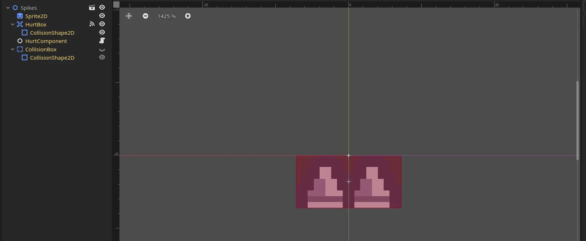

I used a simple rectangle for the collision shape, keeping it simple and sleek. The spikes are configured to deal 1 damage on touch.


### Invincibility Frames

At this point, I decided to add invincibility frames, also commonly referred to as i-frames, to my `HealthComponent`, because right now as soon as I touch the spikes, it instantly sucks all my health. While doing this I found myself instantiating another timer through code. This was the third time I was doing this now so I decided to add the timer initializing logic to my utils script:

```gdscript
func _initialize_timer(_name: String, _wait_time: float):
	var _timer = Timer.new()
	_timer.wait_time = _wait_time
	_timer.one_shot = true
	_timer.name = _name
	return _timer
```

Now I can just call this to make new timers anywhere in my game. Like:

```gdscript

func initialize_invincibility_timer() -> void:
	invincibility_timer = utils._initialize_timer("InvincibilityTimer", invincibility_time)
	add_child(invincibility_timer)
```

After completing this invincibility frames implementation, I hooked it up to the player, and also added a Respawn Timer to add a slight delay between dying and respawning.

On the topic of respawning, I finally wrote the `respawn()` function, so the player now respawns on death. I also tried experimenting with [particles](https://docs.godotengine.org/en/stable/tutorials/2d/particle_systems_2d.html) in Godot. Particles are a very streamlined and straight-forward, highly customizable way of adding [juice](https://en.wikipedia.org/wiki/Game_feel) to your game. I tried making Hurt and Respawn particles.

Here’s a showcase of the holding/throwing mechanic as well as the hurt and respawn. Today’s work was more under-the-hood so I can’t show much for it, but the code-base looks much sleeker.  Many functions were reworked to work better.


With this, I ended work for the day.

# Days 5–8 | June 23 – June 26 {#day-5-8}

## The Disruption

“Tani from Day 5 here, today was spent entirely on writing this devlog and setting up my streaming tools. No work on the game.”,

is the message that’s left here on my page by past Tani. Day 5 was spent on setting up the devlog, its website, and the related tasks. I also decided to use my Twitch account to stream my progress for the jam, which took a while to set up. You can check out my channel [here](https://twitch.tv/infiniTani_). This was also when I had to be out of the city for 5 days, which meant little-to-no work on the game for the first 3 days. However, I did write up the devlog up to Day 4 during this time, so I wouldn't consider the time wasted.

# Day 9 | June 27

## The Look and Feel

Up until now, I had been planning to go the retro platformer route— sunshine and rainbows, [SFXR](https://sfxr.me) sound effects— The usual platformer pipeline. But then, I had a wicked thought, what if instead of jumps, I voiced the grunts? Instead of the usual dying sounds, its me breathing my lungs out? Then one thing lead to another and— The game looks different now.


I saw this and my brain immediately went—

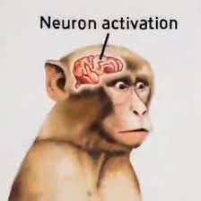

I mean, I’ve always been a dark mode fan, and red on top of that? With 2D lights? Hell yeah.

About the lights, Godot provides a really easy solution for adding 2D lights to your game, you can learn how to do that [here](https://docs.godotengine.org/en/stable/tutorials/2d/2d_lights_and_shadows.html).

Now with a better vision of the game I want to make, let’s get back to the mechanics.

## Unlockables

We have keys in the game, but what are the keys supposed to do? Open the doors! Which doors you ask? Well, the ones I’m about to make.

### Doors

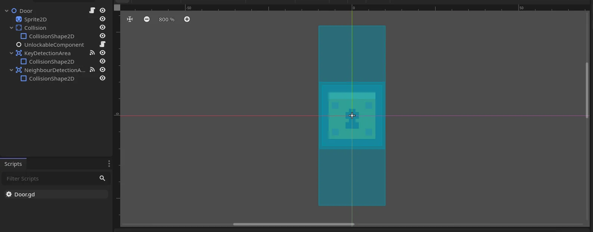

We have a Sprite, a StaticBody2D to handle collisions, and **two** Area2Ds, one that detects the key, and another that detects the neighboring doors. Why the neighbors you may wonder, the answer to that question is because I want my doors to break like a chain reaction, one of them opening unlocks all connected doors like dominoes. At least that’s the plan, for now. I added an `UnlockableComponent` to the Door and a `KeyComponent` to our Key scene, which were just basic scripts with connections to their respective nodes’ Area2Ds. Here’s the script for the `UnlockableComponent` for now:

```gdscript
extends Node
class_name UnlockableComponent

@export_subgroup("Settings")
@export var neighbour_detection_area: Area2D

var neighbouring_unlockables: Array[Node2D]

func _on_detector_area_entered(area: Area2D) -> void:
	var body = area.get_parent()
	var key_component: KeyComponent = utils.get_component(body, "KeyComponent")
	
	if not key_component:
		return
	
	print("Key Detected")
	
	#TODO Should not be able to drop keys behind tiles.

func handle_neighbouring_unlockables() -> void:
	# I want to check all 8 neighbouring tiles for oter Doors.
	pass

func unlock() -> void:
	print("Door unlocked", get_parent().name)
```

## The Build

Now that I had somewhat of a playable game to my name, I wanted to try and run it on the web, which I did. As I had decided to switch to version 4.3 Beta 1, I decided to check out the updates that it brought along for the web builds, which eventually lead me to [this article](https://godotengine.org/article/progress-report-web-export-in-4-3/). Long story short, audio doesn’t work in web builds in this version, bummer. But, 2 days ago Godot released version 4.3 Beta *2,* where they seem to have implemented part of the new changes to Audio Playback for web, so this is why we are now switching, once again, to the latest beta release.

Unfortunately that came with its own set of troubles, and after cleaning up the project for an hour, I could run the new project on the new beta.

At this point, I had decided to upload the game first, so we went on a little tangent to make the branding for the game, the cover art, for one.

After a bit of iteration, this is what I ended up going with. Keep in mind, I didn’t have a lot of time to spare on the art, I had a game to complete.

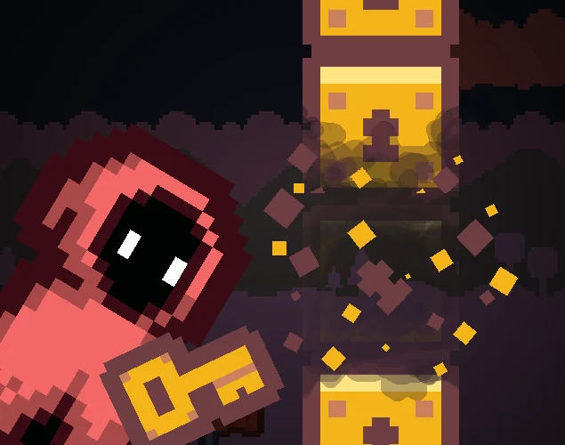

The rest of the day I spent on setting up the website you’re currently on, after which I decided to hit the sack. I should mention that I am still not home at this point in time, so I have lesser time than usual to work on the game.

# Day 10 | June 28

The day started with a great idea.

## The Fireball

### The Particle Effect

Okay, so you’re a wizard, in a dark environment, exploring, and there are already lights in the scene. All of this can only lead to one thing, a fireball! So I once again employed the ever-useful particles to make a flame effect, and I gotta say, I’m very proud of it.


Once again, particles, are, awesome. Use them wherever you can. They add a lot to a game’s feel. 

### Position Flipping Component

With the flame, I also made a new component, the `PositionFlippingComponent` , whose job it is to flip positions, literally. This was a necessity because up until now, when the player is moving left, we simply flip it’s sprite horizontally to make it seem like he’s going that way, not flipping the entire player. One of the problems with this is that the children of the Player node don’t get flipped along with the sprite, and we don’t want that for nodes such as the Item we are holding, which is supposed to follow *behind* the player, or the flame, which is supposed to illuminate the way ahead. To counter this, I made this new component that will change the transform of a node according to the player’s direction. The node also has specified offsets, to account for any use-case scenario.

```gdscript
extends Node
class_name PositionFlippingComponent

@export_subgroup("Settings")
@export var object_to_flip: Node2D
@export var positive_x_offset: float = 10
@export var negative_x_offset: float = 10
@export var positive_y_offset: float = 0
@export var negative_y_offset: float = 0
@export var time_to_tween: float = 0.2

func handle_flipping(threshold_property: float):
	if threshold_property == 0:
		return
	
	var position_tween = create_tween()
	position_tween.set_ease(Tween.EASE_IN)
	
	if threshold_property > 0:
		position_tween.tween_property(object_to_flip, "position", Vector2(positive_x_offset, positive_y_offset), time_to_tween)
	else:
		position_tween.tween_property(object_to_flip, "position", Vector2(negative_x_offset, negative_y_offset), time_to_tween)
```

You may notice that we’re using a Tween for this functionality, so let’s talk about those for a second.

### Tweens

[Tweens](https://docs.godotengine.org/en/stable/classes/class_tween.html) in Godot are basically animations that you can calculate and run through code on the fly, as seen in the script above. Tweens could be used anywhere, be it animating positions, colors, values, and functions. One of the many good things about Tweens is the out-of-the-box easing and transition support, which is awesome. I use tweens almost everywhere that I can, the reason being the more often than not, we want our games to look smooth, which tweens accomplish the best. You can watch this video to learn more about Tweens and their uses.

## UI

STILL A WIP, To be continued.

---

# Epilogue | 21 July 2026

Well, that’s what I said 2 years ago, haha. As you may have read above, I am a very forgetful person, which recently has turned out to be ADHD. I completely sidelined off of completing this, and its safe to say that I won’t be doing it anymore. Apologies for the people looking forward to the UI section and what followed! You CAN still contact me, I am happy to help you out, ‘kay? The game itself is live [here](https://infinitani.itch.io/rise-and-shine). We *did* end up winning the Most Educational Devlog prize though, so there’s that! Thank you for reading this and keep rising! (and shining!)